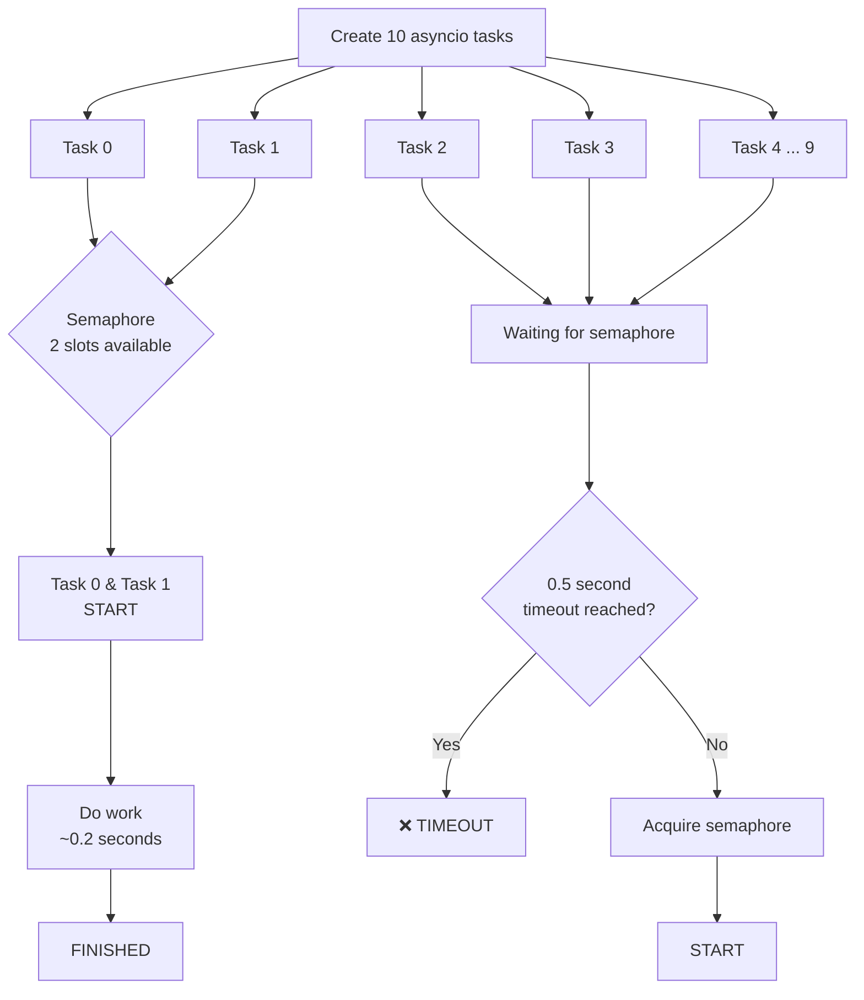
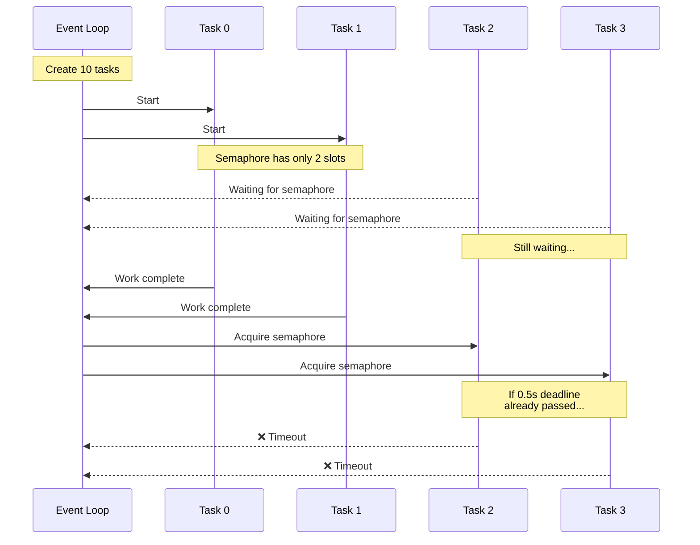

# AsyncIO

> [!IMPORTANT]
>
> We can only have **one running event loop per thread** and by default, we're only going to be running this on one core and one single thread. So basically what that means is we're only going to have one `asyncio.run` call, which is going to be the entry point to our program:
>
> ```py
> import asyncio
> async def dummy_async():
>     await asyncio.sleep(123)
> if __name__ == "__main__":
>     asyncio.run(dummy_async())
> ```

In Python if you push too many tasks into event loop some of them might timeout before Python gets to execute them! If that happened to you you might wanna start batching them and push more tasks into the event loop more moderately. And if you are already batching them, maybe reduce the batch sizes. 

```py
import asyncio
import time


async def worker(task_id, semaphore):
    created = time.monotonic()

    # Give every task only 0.5 seconds from creation.
    deadline = created + 0.5

    async with semaphore:
        started = time.monotonic()

        # How long did we wait before getting a chance to run?
        queue_time = started - created

        print(
            f"Task {task_id:02d} STARTED "
            f"(waited {queue_time:.3f}s)"
        )

        # Simulate actual work.
        await asyncio.sleep(1)

        print(f"Task {task_id:02d} FINISHED")


async def run_with_timeout(task_id, semaphore):
    try:
        # IMPORTANT:
        # The timeout starts when this coroutine is scheduled,
        # not when it finally acquires the semaphore.
        await asyncio.wait_for(
            worker(task_id, semaphore),
            timeout=0.5,
        )

    except asyncio.TimeoutError:
        elapsed = time.monotonic() - start_time

        print(
            f"Task {task_id:02d} ❌ TIMEOUT "
            f"({elapsed:.3f}s after creation)"
        )


async def main():
    global start_time
    start_time = time.monotonic()

    # Only 2 tasks can actually execute at once.
    semaphore = asyncio.Semaphore(2)

    # But we create 10 tasks immediately.
    tasks = [
        asyncio.create_task(
            run_with_timeout(i, semaphore)
        )
        for i in range(10)
    ]

    await asyncio.gather(*tasks)
asyncio.run(main())
```

Note that here we are forcing the timeout kinda by limiting how many semaphores the event loop can have. But if you'd like to see a visualization of it:



And here's the timeline, which I think makes the phenomenon even clearer:



> [!TIP]
>
> To overcome the limitation of one event loop per process you can of course as you might have guessed it create multiple processes and in each hen start an event loop.