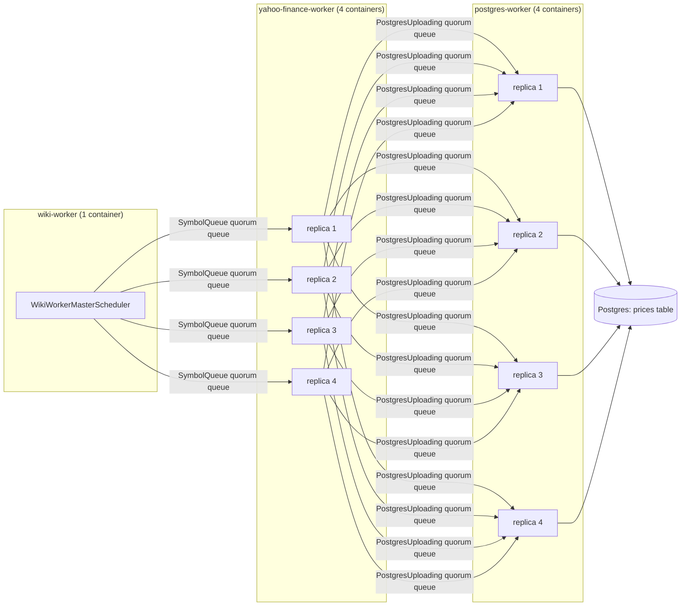

# Scraper Pipeline over RabbitMQ

Same pipes-and-filters scraper as [`scrapper-pipeline-design-pattern`](../scrapper-pipeline-design-pattern),
reimplemented as separate Docker containers wired together with RabbitMQ quorum queues instead of
in-memory `multiprocessing.Queue`s and threads: `wiki.py` scrapes S&P 500 tickers, `yahoo_finance_price.py`
fetches a price per ticker, `postgres.py` writes them to Postgres. `pipelines/reader.py`
(`PipelineTopology`) still reads `pipelines/wiki_yahoo_scraper_pipeline.yaml` and resolves it into
RabbitMQ queue/exchange names; `config.py` is the single place every worker reads its settings from
(Postgres, RabbitMQ, the pipeline YAML path).

The pipeline YAML is still the single source of truth for pipeline shape, exactly like the original:

- **Worker identity**: every container runs the same generic `run_worker.py`, which reads `WORKER_NAME`
  from its environment and reflectively resolves `location`/`class` from the YAML (`importlib`), the same
  way the original's `YamlPipelineExecutor` did — no worker file hardcodes its own name.
- **Instance counts**: `tools/render_compose.py` reads the YAML and generates one Compose service per
  worker, with `deploy.replicas` set from `instances`. `compose.yml` only holds static infra
  (RabbitMQ, Postgres, pgAdmin); worker services live entirely in the generated file. Adding, removing,
  or rescaling a stage is a YAML-only change — `make dev` regenerates the services before starting.

## Topology



`instances` in the pipeline YAML maps to `deploy.replicas` in the generated Compose service: each
replica is a single-process consumer competing for messages on the same quorum queue, the RabbitMQ
analogue of the original's N threads competing on one in-memory queue.

## Queue modes: direct vs. fanout

Same YAML shape as the original: a queue takes an optional `mode`, defaulting to `direct`.

- **`direct`**: one physical quorum queue. A queue may be declared as `input_queue` by exactly one
  worker stage; that stage's replicas still compete for messages round-robin via RabbitMQ's default
  competing-consumers behavior. Declaring the same `direct` queue as `input_queue` on a second stage is
  a load-time error in `PipelineTopology`.
- **`fanout`**: `PipelineTopology.declare()` creates a fanout exchange plus one quorum queue per
  subscribing stage (named `<queue>.<worker-name>`), and binds each. Every subscribing stage sees every
  message; replicas within one stage still compete over that stage's own queue. Worker code stays
  unaware fan-out is happening — it just publishes to `output_targets()` / consumes from
  `input_queue_name()`.

`PipelineTopology.declare()` is idempotent and called by every worker at startup, so containers can be
started in any order without a dedicated init step.

## No poison-pill propagation, and no self-timeout either

The original in-memory pipeline needed a central orchestrator to count live threads and inject exactly
enough `"DONE"` sentinels for the next stage's instance count, because a producer thread had no way to
know how many consumer threads were reading its queue. In this RabbitMQ version there is no single
process that can see every container, so `WikiWorker` is a one-shot container (publishes every ticker,
then exits) while `YahooFinanceWorker` and `PostgresWorker` replicas are plain long-running consumers
(`channel.start_consuming()`) that never decide on their own that the pipeline is "done."

An earlier version of this had them exit after N seconds of no messages, which seemed like a reasonable
stand-in for "the pipeline finished" — until a downstream stage stalled (e.g. an upstream API rate-limit)
while messages were still queued upstream: the idle consumer had no way to distinguish "genuinely
finished" from "stuck waiting," exited anyway, and orphaned whatever hadn't arrived yet. That ambiguity
can't be fixed by tuning the timeout; it's unresolvable from inside a single consumer. So there's no
timeout at all now — replicas run until they receive `SIGTERM`, finish/ack whatever they're mid-processing
if possible, and stop. In production, deciding *how many* replicas should exist (including scaling to
zero when a queue is empty, and back up when it isn't) is an external, observable decision — see
[`k8s/`](./k8s) for the KEDA-based reference design.

## Running it

```bash
make init   # copies .env.example -> .env, uv sync for local tooling
make dev    # regenerates compose.generated.yml from the pipeline YAML, then docker compose up --build
```

`wiki-worker` runs once and exits; `yahoo-finance-worker` and `postgres-worker` each run 4 replicas and
keep consuming indefinitely. Check results in Postgres (`prices` table) or via pgAdmin on
`PGADMIN_EXPOSED_PORT`, and inspect queues via the RabbitMQ management UI on
`RABBITMQ_MANAGEMENT_EXPOSED_PORT`.

```bash
make down   # docker compose -f compose.yml -f compose.generated.yml down -v
```
